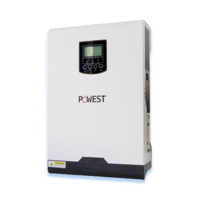
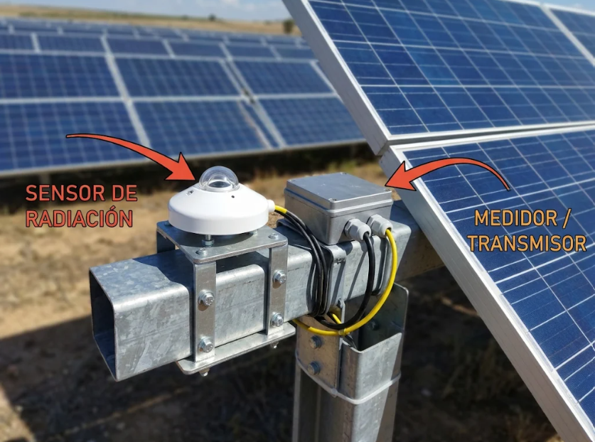
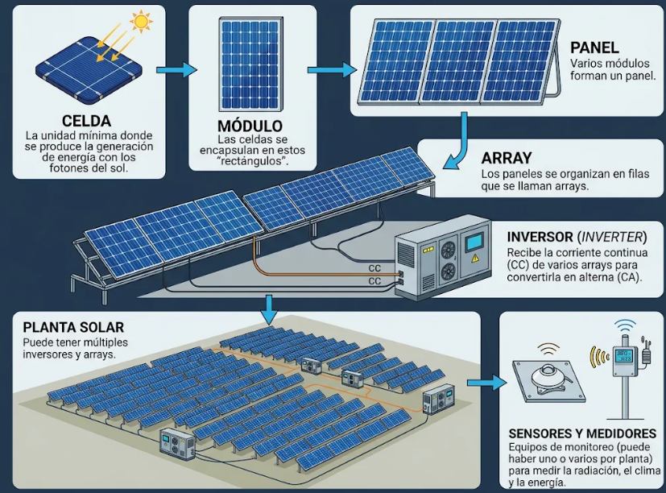
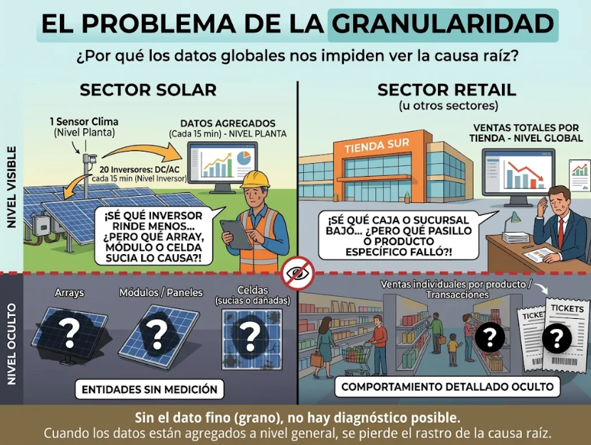

# Diseño del Proyecto

## Objetivos

Analizar los datos disponibles para intentar intuir dónde pueden estar los problemas y si es necesario desplazar o no a un equipo de ingenieros a las plantas.

-----------------------------------------------------------------------------------------------
El proceso funciona de la siguiente manera:

La luz solar llega a los paneles solares, que producen corriente continua **DC**. Por medio de un dispositivo llamado *inverter*, se **transforma o convierte** la corriente **DC** en corriente alterna **AC**, que es la forma utilizada por la mayoría de los equipos eléctricos y por la red eléctrica. Hay cierta eficiencia del *inversor*, que viene de la división AC/DC * 100. Se compara la potencia AC de salida con la potencia DC de entrada.

Los sensores miden las condiciones de operación, como la irradiancia y la **temperatura** de los paneles y **ambientales**. El medidor registra la energía eléctrica entregada a la instalación o a la red. Estos datos se comparan para detectar si la planta produce menos de lo esperado.

Luego pasa a las redes por medio de esos palos donde pasa la electricidad

## Palancas

Estas mueven el proceso de negocio

-----------------------------------------------------------------------------------------------

Hay dos tipos. La **palanca accionable** la mueve la empresa con una decisión: limpiar, reparar, cambiar un sensor. La **palanca automática** la pone el entorno y solo se puede medir; no se acciona, pero sin ella no se sabe cuánto debería producir la planta. La irradiación es de este segundo tipo.

-----------------------------------------------------------------------------------------------

### Luz Solar, Irradiación e Irradiancia (Palanca 1, automática)

**Irradiación**: Es la energía solar acumulada por unidad de superficie durante un periodo **kWh/m²**
Kilovatio hora por metro cuadrado **durante un periodo**.

A mayor irradiación, mayor DC generada pero no es monótono, llega un momento que el panel no recibe más.

**Irradiancia**: Indica cuánta potencia solar recibe cada metro cuadrado de la planta en ese instante
**W/m²** vatios por metro cuadrado

-----------------------------------------------------------------------------------------------

### Estado de los Paneles (Palanca 2)

Deben estar limpios y con un correcto funcionamiento para generar la mayor energía DC posible

-----------------------------------------------------------------------------------------------

### Eficiencia de los inverters

Siempre hay una pérdida en la transformación de DC a AC, pero debe ser la mínima posible. También deben estar en correcto estado y funcionamiento.

**DC (corriente continua)**: fluye en una sola dirección. Los paneles producen electricidad DC. Se mide como potencia en W o kW; también puede describirse con voltaje en V y corriente en A.

**AC (corriente alterna)**: cambia de dirección periódicamente. El inversor convierte la electricidad DC de los paneles en AC para alimentar equipos o entregar energía a la red. También se mide en W o kW (potencia), V y A.

Este es un inverter

-----------------------------------------------------------------------------------------------

### Medidores y sensores

Si se estropean y no miden bien perdemos la trazabilidad y la posibilidad de detectar fallos.

Los sensores miden las condiciones de operación, como la irradiancia y la **temperatura** de los paneles y **ambientales**. El medidor registra la energía eléctrica entregada a la instalación o a la red

Esto es un medidor y un sensor. Normalmente la planta, la instalación completa en el terreno, está montada directamente sobre las estructuras de soporte de los paneles

Estos son

-----------------------------------------------------------------------------------------------

## KPI

- Irradiación (`irradiacion_wh_m2`), energía solar recibida en la ventana de 15 minutos, en Wh/m²
- Eficiencia del inverter, AC/DC * 100
- Potencia DC (`potencia_dc_kw`), medida en kW de corriente continua
- Potencia AC (`potencia_ac_kw`), medida en kW de corriente alterna
- Temperatura ambiente (`temperatura_ambiente_c`), en grados Celsius
- Temperatura del módulo (`temperatura_modulo_c`), en grados Celsius
- Desviación frente a lo esperado, en porcentaje. Negocio admite hasta un 6 %, por encima se investiga

El último es el que decide. Falta fijar contra qué se calcula ese esperado, queda anotado para la fase de preguntas.

## Entidades

No se trata de cliente, producto, proveedor, tienda, etc. Pero en este caso estos serían:

Celda -> Módulos -> Paneles -> Arrays -> Inversores -> Planta

Con varios sensores y medidores, como explica la imagen

## Granularidad

De acuerdo a los datos de entrada:

Planta1_Generacion.csv
Planta1_Sensores.csv
Planta2_Generacion.csv
Planta2_Sensores.csv

- Se tienen dos plantas con **ventanas temporales** de 15 minutos durante 34 días como el grano de cada fila,
- 2 plantas
- Inverters: varios por planta
- Sólo un sensor de irradiación por *Planta*
- Sólo un sensor de temperatura ambiente por *Planta*
- Sólo un sensor de temperatura del módulo por *Planta*

### Limitación

Al tener los sensores climáticos a nivel de toda la *Planta* y la medición eléctrica solo hasta cada *Inversor*, podemos identificar qué inversor baja su rendimiento, pero es imposible saber qué componente específico lo provoca aguas abajo, ya que no hay "ojos" en cada array, módulo o celda (suciedad, sombra local o daño).

Esto es exactamente lo mismo que ocurre en otros sectores:

**En Retail:** Sabes cuántas ventas registró cada Caja de la Tienda, pero sin el detalle transaccional por pasillo o producto, no puedes saber qué artículo específico dejó de venderse.

**En Banca:** Ves el balance de la Sucursal y la cartera total de cada Ejecutivo, pero sin el detalle por cliente o contrato, no puedes detectar qué producto financiero concreto está generando la pérdida.

Básicamente: "Diagnóstico a mitad de camino". Sabemos qué inversor rinde menos, pero sin el dato fino (grano) de las entidades inferiores, no es posible encontrar la causa raíz.

## Adenda al diseño

Esta sección se añade después de la fase de calidad de datos, cuando ya se vio el dato real. El diseño se escribió antes de mirar las fuentes y por eso le faltaba nombrar una segunda familia de entidades. No cambia nada de lo anterior, solo lo completa.

Hasta aquí se habló de las **entidades físicas**, que son los objetos del campo. Para construir tablas hace falta otra familia, las **entidades de tabla**, que no son objetos sino las dos cosas por las que se puede cortar y agrupar el dato.

| Familia | Qué es | Cuáles son aquí |
|---|---|---|
| Entidades físicas | los objetos que hay en el terreno | Celda, Módulo, Panel, Array, Inversor, Planta |
| Entidades de tabla | por lo que se corta y se agrupa | Activo (Inversor, Planta) y Tiempo (las temporalidades) |

**Activo.** El inversor y la planta son las dos únicas entidades que tienen medida propia, y una está dentro de la otra. Dan dos lecturas del mismo dato: el inversor dice cuál falla, la planta dice cuánto se pierde en total.

**Tiempo.** La fecha de 15 minutos se separa en varias temporalidades, y cada una es un nivel de tabla distinto.

| Temporalidad | Una fila es |
|---|---|
| 15 minutos | un inversor en una ventana (el grano original) |
| Hora | un activo en una hora |
| Día | un activo en un día |
| Periodo | un activo en los 34 días completos |

Con estas dos entidades salen todas las tablas del proyecto, y siempre hacia arriba: de 15 minutos a hora, de hora a día, de inversor a planta. Nunca al revés, porque al agrupar se pierden columnas y la única tabla que las tiene todas es el grano de 15 minutos.

Ojo con esto: que exista el tiempo no arregla la limitación. Las tablas más finas que el inversor siguen sin poder construirse, porque no hay entidad física con dato por debajo de él.

## Preguntas Semilla

Habiendo entendido las palancas, KPIs y entidades ya podemos plantear las preguntas semilla:

**Sobre la irradiación:**

- ¿Llega suficiente irradiación todos los días?
- ¿Es similar en ambas plantas?
- ¿Cómo es su distribución por hora?

**Sobre las plantas:**

- ¿Les llega la misma cantidad de irradiación?
- ¿Tienen similar número de inverters?
- ¿Generan similar cantidad de DC?
- ¿Generan similar cantidad de AC?

**Sobre la generación de DC:**

- ¿Cuál es la relación entre irradiación y generación de DC?
- ¿Se ve afectada en algún momento por la temperatura ambiente o del módulo?
- ¿Es similar en ambas plantas?
- ¿Cómo se distribuye a lo largo del día?
- ¿Es constante a lo largo de los días?
- ¿Es constante en todos los inverters?
- ¿Ha habido momentos de fallos?

**Sobre la generación de AC:**

- ¿Cuál es la relación entre DC y generación de AC?
- ¿Es similar en ambas plantas?
- ¿Cómo se distribuye a lo largo del día?
- ¿Es constante a lo largo de los días?
- ¿Es constante en todos los inverters?
- ¿Ha habido momentos de fallos?

**Sobre los medidores y sensores:**

- ¿Son fiables los datos de irradiación?
- ¿Son fiables los datos de temperatura?
- ¿Son fiables los datos de DC?
- ¿Son fiables los datos de AC?
- ¿Son similares los datos entre ambas plantas?