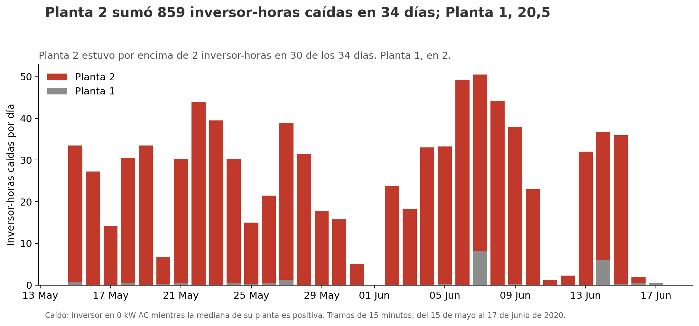
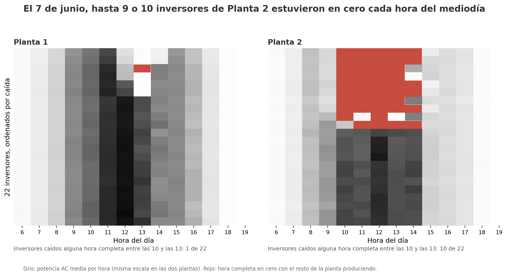
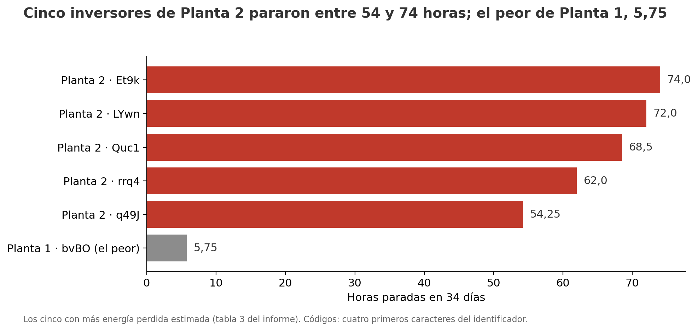
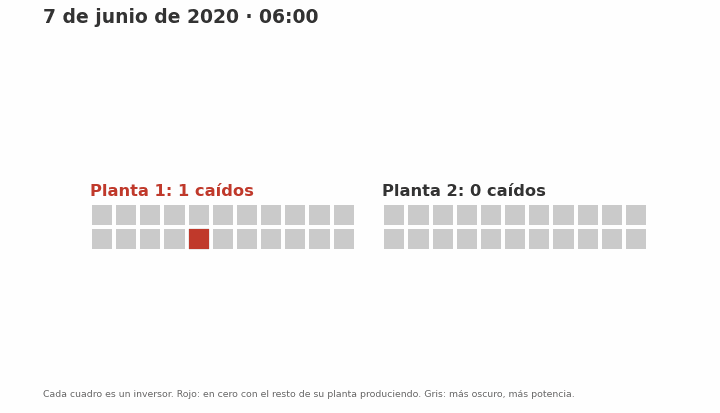

# Storyboard

**Resultado:** tres exhibits y una animación que cuentan dónde pierden energía las plantas solares. Leídos solo los títulos, la historia es completa.

1. Planta 2 sumó 859 inversor-horas caídas en 34 días; Planta 1, 20,5.
2. El 7 de junio, hasta 9 o 10 inversores de Planta 2 estuvieron en cero cada hora del mediodía.
3. Cinco inversores de Planta 2 pararon entre 54 y 74 horas; el peor de Planta 1, 5,75.

Recomendación: enviar el equipo de ingenieros a Planta 2, empezar por esos cinco inversores y pedir los registros de eventos entre las 9 y las 15 horas.

---

## Planta 2 sumó 859 inversor-horas caídas en 34 días; Planta 1, 20,5

Qué es importante: el problema está en Planta 2 y se repite casi todos los días.
Por qué te importa: la pérdida estimada es de unos 785 MWh, el 16 % de lo que Planta 2 habría generado, y justifica el desplazamiento de un equipo.

Soporte analítico: 30 de 34 días con más de 2 inversor-horas caídas en Planta 2, frente a 2 en Planta 1. Los cinco peores días suman 227,5 de las 859 horas.
Fuente y nota: datos originales de generación de las dos plantas, 15 de mayo a 17 de junio de 2020 · DATO para las horas, ESTIMADO para los MWh.

## El 7 de junio, hasta 9 o 10 inversores de Planta 2 estuvieron en cero cada hora del mediodía

Qué es importante: los equipos de Planta 2 se paran juntos y a la hora de más sol.
Por qué te importa: la hora de mayor producción es la que más energía deja de entregar, y el 95 % de los tramos caídos de Planta 2 cae entre las 9 y las 15 horas.

Soporte analítico: 3.250 de 3.436 tramos en cero de Planta 2 entre las 9 y las 15 horas. Planta 1 tiene 82 tramos en cero en todo el periodo.
Fuente y nota: datos originales de generación · DATO. Los datos muestran cuándo se paran los inversores, no por qué.

## Cinco inversores de Planta 2 pararon entre 54 y 74 horas; el peor de Planta 1, 5,75

Qué es importante: la pérdida se concentra en pocos equipos y se sabe cuáles son.
Por qué te importa: esos cinco equipos explican el 40 % de la energía perdida estimada y son por donde empezar la visita.

Soporte analítico: 315.063 kWh estimados entre los cinco, de 784.877 kWh en Planta 2. Cinco de 22 equipos.
Fuente y nota: datos originales de generación · horas DATO, kWh ESTIMADO con la mediana de los inversores vecinos en el mismo instante.

## Animación

El 7 de junio, cuadro por cuadro. Cada cuadrado es un inversor, rojo cuando está en cero con el resto de su planta produciendo.
