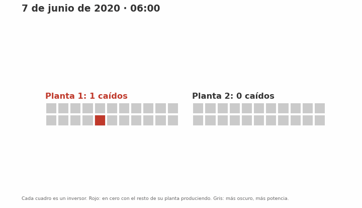
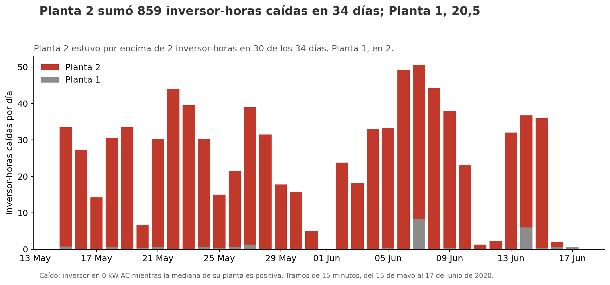
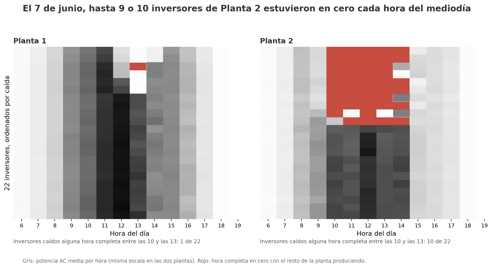
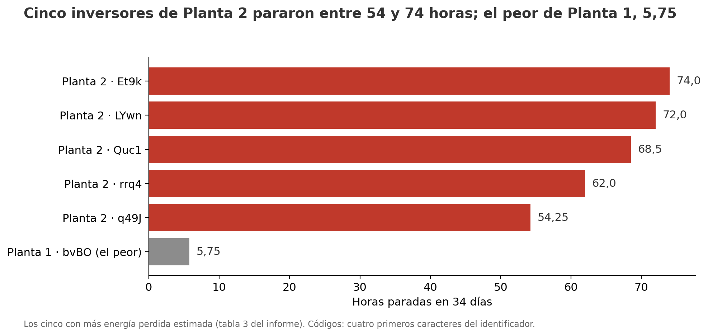
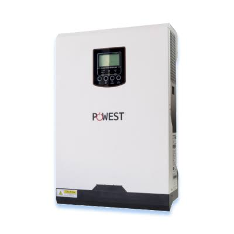

# Plantas solares: dónde se pierde la energía

## De qué trata este proyecto

Este es un caso de análisis de datos sobre dos plantas solares. Cada una tiene 22 inversores, que son los equipos que convierten la corriente de los paneles en la que usa la red, y un sensor meteorológico. La dirección de operaciones sabía que se estaba perdiendo energía, pero no sabía en qué planta ni en qué equipos.

Para responderlo se trabajó con dos tipos de datos de 34 días, del 15 de mayo al 17 de junio de 2020, en lecturas cada 15 minutos. Por un lado, la generación de cada inversor (136.476 filas). Por otro, las temperaturas y la irradiación que registra el sensor de cada planta (6.441 filas).

El trabajo siguió las fases de un proyecto de analítica. Se revisó la calidad de los datos, se unieron las fuentes, se analizó dónde y cuándo se pierde energía, se convirtió lo encontrado en insights con su decisión y se armó un business case con cifras ilustrativas. Al final hay una pieza para dirección, una guía para operación y una página para quien solo tenga un minuto.

Si tienes poco tiempo, lee la respuesta en tres números. Si quieres entender cómo se llega a ella, sigue con la lógica del inversor caído y con las fases del proyecto.

## En una frase

Dos plantas solares con los mismos 22 inversores cada una. Una pierde el 0,3 % de su energía por equipos parados. La otra, el **16 %**.

Cada cuadrado es un inversor y el rojo marca uno en cero mientras el resto de su planta produce. A mediodía llegan a ser hasta 10 de 22 en Planta 2.

## La pregunta

Con los datos de generación y de sensores de esos 34 días, en tramos de 15 minutos, ¿hace falta enviar ingenieros a las plantas, y a cuál?

## La respuesta en tres números

| Número | Qué dice |
|---|---|
| **859** | inversor-horas caídas en Planta 2 en 34 días. En Planta 1, 20,5 |
| **30 de 34** | días con más de 2 inversor-horas caídas en Planta 2. En Planta 1, 2 |
| **95 %** | de los tramos en cero de Planta 2 cae entre las 9 y las 15 horas |

**Decisión.** Enviar el equipo a Planta 2, empezar por los cinco inversores con más energía perdida (entre 54 y 74 horas paradas cada uno, frente a 5,75 del peor de Planta 1) y pedir los registros de eventos entre las 9 y las 15 horas. Los diez primeros concentran el 67 % de las horas caídas.

## Cómo se detecta un inversor caído

La idea es comparar a cada inversor con su propia planta en el mismo instante.

| Paso | Qué se hace | Para qué sirve |
|---|---|---|
| 1 | En cada tramo de 15 minutos se calcula la mediana de la potencia AC de los 22 inversores de la planta | tener la referencia de lo que produce la planta en ese instante |
| 2 | Si esa mediana es mayor que 0, hay sol y la planta produce | descartar la noche, cuando todos marcan 0 y no hay avería |
| 3 | Un inversor está caído si marca 0 kW mientras la mediana es mayor que 0 | encontrar al que se queda parado mientras sus vecinos producen |
| 4 | Se suman los tramos caídos por planta y por día | saber cuánto falló cada día |
| 5 | Cada tramo dura 15 minutos, así que se multiplica por 0,25 | pasar a inversor-horas |

Por ejemplo, a las 12:15 la mediana de Planta 2 es 9 kW y un inversor marca 0 kW. Hay sol, sus vecinos producen y él no, así que ese tramo cuenta como caído. A las 2 de la madrugada la mediana es 0 y todos marcan 0, porque no hay sol, y no cuenta.

Si la regla fuera "mediana mayor o igual a 0", cada noche contaría como caída y las horas saldrían infladas. Además se compara con el mismo instante y no con otra hora, porque a las 9 de la mañana y a la 1 de la tarde no se espera la misma potencia. La mediana del mismo instante ya trae el sol y las nubes.

## Qué vale la decisión

Con cifras ilustrativas en pesos colombianos y el escenario más prudente (se recupera la mitad de lo perdido y la energía se valora a 220 pesos por kWh), enviar el equipo recupera unos 392 MWh en 34 días, que valen unos 86 millones de pesos. La visita se estima en 85 millones, así que se paga en cerca de un mes. El detalle y los otros dos escenarios están en el [business case](05_resultados/Business_Case/business_case.md) y en su [hoja de cálculo](05_resultados/Business_Case/Business_Case_Planta2.xlsx). Los datos no traen tarifa ni costos, así que de ellos sale solo la energía perdida.

## Para leer los datos

| Término | Qué es |
|---|---|
| Irradiación | luz solar que llega por metro cuadrado. En estos datos se lee como kW/m² instantáneos, donde 1,0 es sol pleno |
| Panel | convierte la luz en corriente continua |
| Inversor | equipo que convierte esa corriente continua en alterna, la que usa la red |
| DC | corriente continua, la que producen los paneles |
| AC | corriente alterna, la que entrega el inversor |
| Eficiencia | AC dividida entre DC. Una planta sana ronda el 98 % |
| kW, kWh y MWh | kW es potencia en un instante, kWh es energía (potencia por tiempo) y 1 MWh son 1.000 kWh |
| Tramo | una lectura cada 15 minutos |
| Mediana | el valor del medio: la mitad de los inversores produce más y la mitad menos |
| Inversor caído | marca 0 kW AC mientras la mediana de su planta, en ese mismo instante, produce |
| Inversor-hora | un inversor caído durante una hora. Cuatro tramos caídos son una inversor-hora |

## Cómo se hizo

| Fase | Qué pasó | Documento |
|---|---|---|
| Diseño | objetivos, palancas y KPI del problema | [Diseño](01_Documentos/02_Diseño.md) |
| Calidad | cuatro fuentes sin nulos ni duplicados; la DC de Planta 1 venía 10 veces alta y se corrigió; un error de fechas inflaba el periodo a 45 días y se corrigió; 198 ventanas sin lectura que se dejan sin imputar | [Informe de calidad](05_resultados/Calidad_Datos/informe_calidad_datos.md) |
| Integración | generación y sensores unidos por fecha, hora y planta | [Informe de integración](05_resultados/Integracion/informe_integracion.md) |
| Análisis | captación, generación, parones por inversor y clasificación de cada lectura | [Informe de análisis](05_resultados/Analisis/informe_analisis.md) y [hallazgos](05_resultados/Analisis/hallazgos.md) |
| Insights | cinco insights con su nivel de evidencia y su decisión | [Insights](05_resultados/Insights/insights.md) |
| Exhibits | tres gráficos y una animación | [Storyboard](05_resultados/Exhibits/storyboard.md) |
| Business case | valor de la decisión en pesos, con tres escenarios | [Business case](05_resultados/Business_Case/business_case.md) |

## Un hallazgo que queda abierto

Cuatro inversores de Planta 2 no reportan del 19 al 29 de mayo, el 28 % de sus registros. Esas horas no cuentan como caídas porque sin lectura no se sabe si estaban parados o solo desconectados. Si estuvieran parados, la pérdida subiría unos 297 MWh sobre los 785 MWh actuales. Es lo primero que habría que preguntar a operación.

## Lo que no se puede decir

- **La causa.** Los datos no traen alarmas, cortes de red ni órdenes de limitación. Esas explicaciones no se pueden confirmar ni descartar.
- **El dinero real.** No hay tarifa ni costos. La pérdida se expresa en MWh, y su valor en pesos es una ilustración.
- **Qué parte de cada inversor falla.** Los datos llegan al nivel del inversor, no de arreglos, módulos ni celdas, así que la visita cubre equipos completos.
- **Otras épocas del año.** Son 34 días de un solo periodo.
- **Una medida exacta de la energía perdida.** Es una estimación con la mediana de los inversores vecinos en el mismo instante.

## Entregables por público

| Público | Pieza |
|---|---|
| Dirección | [Presentación de 5 diapositivas](05_resultados/Entregables/Direccion/Planta2_decision_direccion.pptx) |
| Operación | [Guía de revisión de Planta 2](05_resultados/Entregables/Operacion/Guia_revision_Planta2.docx) con dónde ir y qué preguntar |
| General | [El caso en 60 segundos](05_resultados/Entregables/General/caso_en_60_segundos.html), página para abrir en el navegador |

## Estructura

| Carpeta | Contenido |
|---|---|
| `01_Documentos/` | diseño, diccionario de datos, consultas de negocio e imágenes |
| `02_datos/` | originales, datos analíticos y cachés |
| `03_notebooks/` | calidad, integración, análisis y exhibits |
| `04_scripts/` | `utils.py` |
| `05_resultados/` | informes, insights, exhibits, business case y entregables |

## Cómo reproducirlo

1. Instalar las dependencias con `uv sync` (Python 3.12 o superior).
2. Ejecutar los notebooks de `03_notebooks/` en orden: calidad, integración, análisis y exhibits.
